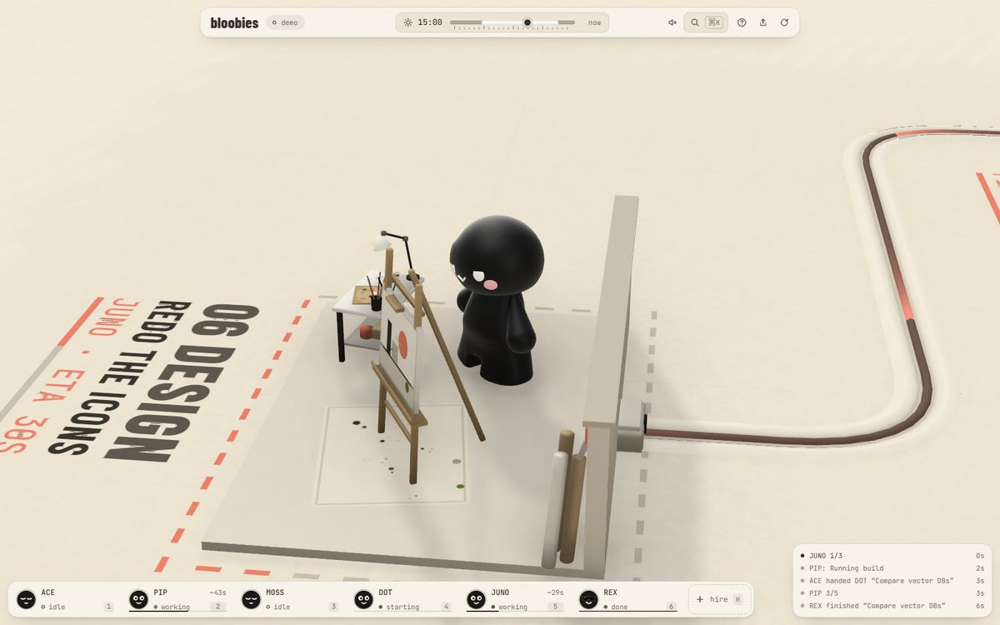
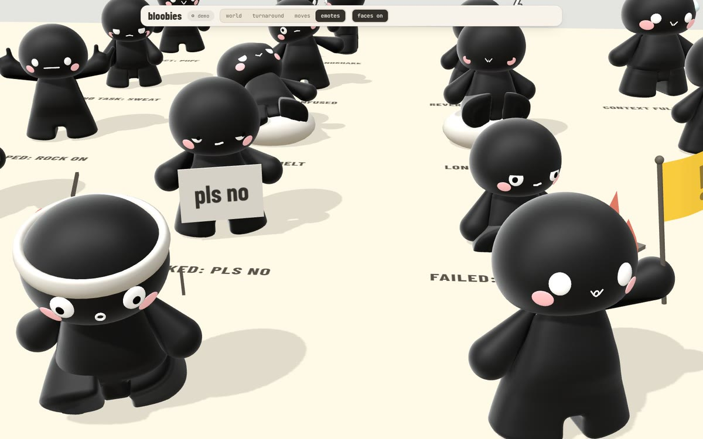
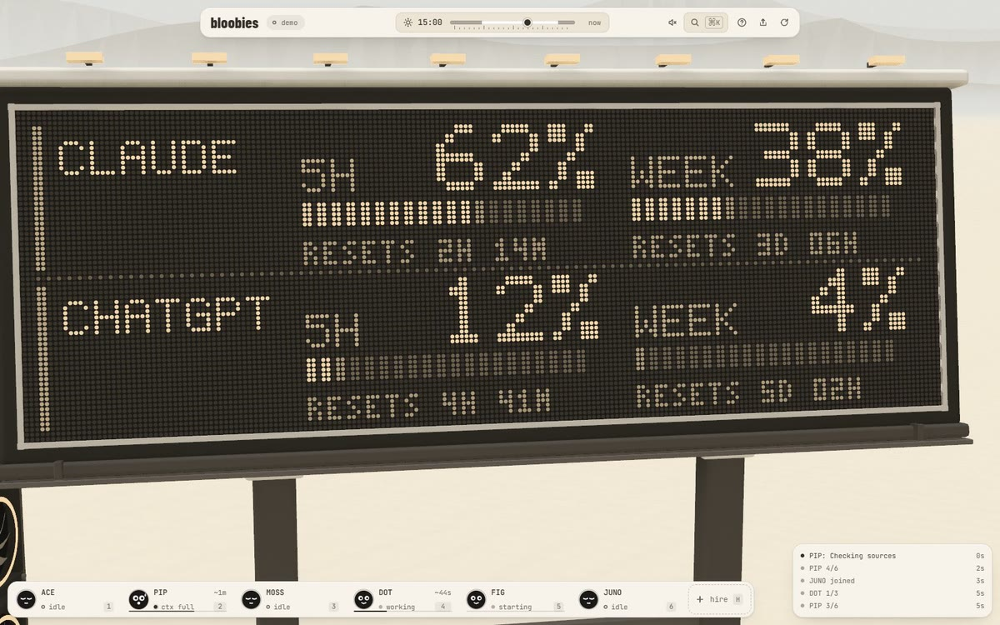
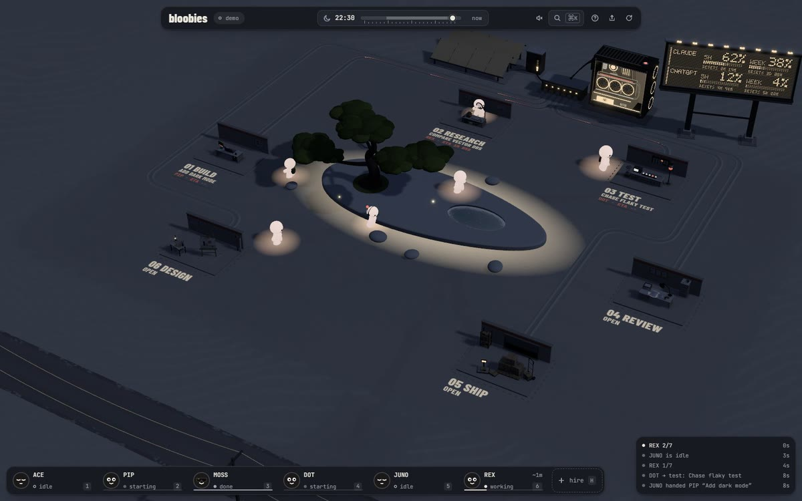

# bloobies for Claude Code

Watch your Claude Code agents work as a little crew at [bloobies.ai](https://bloobies.ai).


## Install

In Claude Code:

```text
/plugin install bloobies --marketplace bloobies-ai/bloobies
```

Then open [bloobies.ai](https://bloobies.ai) and sign in. It finds your agents by itself.

To see your Claude plan's usage (5-hour and weekly) on the world's board, run this once in Claude Code:

```
/bloobies:usage
```

Claude Code passes your plan's usage only to its status line, so this works where the status line runs: Claude Code
in a terminal (Pro and Max plans). The Claude desktop app shows your usage itself and doesn't run status lines, so
there the board's Claude row stays empty.

## What you get

<table>
  <tr>
    <td width="50%"></td>
    <td width="50%"></td>
  </tr>
  <tr>
    <td>Every agent and subagent is a bloobie, working at the station for what it's doing, with its task on the floor.</td>
    <td>They show how it's going: a "pls no" sign when blocked, a flag when one needs you, a headband when it's urgent.</td>
  </tr>
  <tr>
    <td></td>
    <td></td>
  </tr>
  <tr>
    <td>Your plan's 5-hour and weekly limits, and when they reset, on the board.</td>
    <td>Day turns to night with your own clock.</td>
  </tr>
</table>

## What it runs, reads and sends

In short: a small bridge runs on your machine and listens on `127.0.0.1` only. Once you link this computer to your
account, it sends a stripped-down picture of your crew (who works, in what state, at which station) to your own
private channel, so your bloobies.ai tab can show it on any device. Your prompts, code, file names, paths, commands
and keys stay on your machine.

### What it runs

- **At each session start**, `scripts/start.mjs` (the SessionStart hook, about 100 ms, prints nothing) checks for the
  bridge on `127.0.0.1:5318`, and starts `bridge/cli.mjs` in the background if it isn't running. The bridge listens
  on `127.0.0.1` only, so nothing outside this machine can reach it. It stops by itself after 30 idle minutes.
- **On every other hook event**, `scripts/hook.mjs` runs in the background, so it never slows Claude Code down. It
  passes the hook's JSON to the bridge at `http://127.0.0.1:5318/hook`, and does nothing else. If no bridge is
  running, it quietly exits.
- **To link this computer**, the first time, the bridge asks bloobies.ai for a one-time code and opens
  `https://bloobies.ai/#link=CODE` in your browser (at most once a day until you link it). Nothing is sent until you
  click "Link this computer" there. The bridge then gets a key for your account, which it keeps in the plugin's data
  folder.
- **It never starts agents on its own.** The bridge can start a Claude Code, Codex or Cursor run only when asked by a
  page that holds the bridge's private token. The plugin never gives that token to bloobies.ai, so from bloobies.ai
  you watch, and you direct your agents in Claude Code itself.

### What it reads (on this machine only; nothing it reads is uploaded)

- **The hook JSON** that Claude Code passes to each hook: the session id, the event, the tool's name and input, and
  the working folder. The bridge boils this down to the world's events: which agent, what state it's in, which
  station it's at, and a short task label.
- **The end of each session's transcript** (the last 256 KB of the file Claude Code names in the hook JSON), for the
  context-size meter. Only the token counts are kept, never message text.
- **Codex's session logs** (`~/.codex/sessions`), for their token-count rows only, to show Codex's limits on the
  usage board.
- **`~/.bloobies/claude-limits.json`**, if it exists, for your Claude plan's 5-hour and weekly limits. This plugin
  doesn't write it; the optional bloobies status line does.
- **Your `PATH` and the usual install folders**, to see which agent programs (Claude Code, Codex, Cursor CLI) you
  have.

### What it writes

- **The plugin's data folder:** `bridge.log`, `relay.json` (this computer's key, readable only by you), and the
  date the link page was last opened.
- **`~/.bloobies`:** a list of recent project folders, and the hook and MCP settings files that runs started by the
  bridge use.
- **It never changes your Claude Code settings or permissions**, except your status line, and only when you run
  `/bloobies:usage`. Claude Code gives your plan's usage only to the status line command, so that sets it to
  `~/.bloobies/statusline.mjs` (a copy of `bridge/statusline.mjs`). A status line you already have keeps running
  through it and still shows. It keeps only the two percentages and their reset times, in
  `~/.bloobies/claude-limits.json`, and backs up `settings.json` first. `/bloobies:usage off` puts it all back.

### What it sends, and to whom

- **To your private channel, once linked.** The bridge sends the world's events to a private channel that only your
  account can open, on [Supabase](https://supabase.com) Realtime, which bloobies.ai uses to carry them. It sends only
  while one of your bloobies.ai tabs is open and in view, at most one batch every two seconds. Before anything leaves
  this machine (`bridge/relay.mjs`), each event is cut down to:
  - agents: a random id, the bloobie's name, whether it leads, and a helper's role;
  - tasks: a random id, the station, and the station's verb as the label ("Building"), never your prompt's words;
  - states: working, idle, waiting for you ("Wants approval" or "Has a question", never the question itself), done,
    stopped, and progress counts;
  - the context meter, and your plan's limits as percentages with their reset times.

  Never sent: prompts, messages, file names, paths, commands, error text, session ids, or your project folder's name.
  bloobies.ai's servers don't store these events; the channel passes them to your tab and keeps nothing.
- **To pages on this machine**, over a WebSocket on `127.0.0.1`, in full (with task labels and messages), since
  they never leave it.
- **Who can connect to the bridge:** only pages from `https://bloobies.ai` and pages served from this machine. Any other website is
  refused.
  - A bloobies.ai page can only watch. It can't start, direct or answer agents, and it never sees your folder list.
  - Directing takes the bridge's token, which only a link made on this machine carries.
- **To unlink:** delete `relay.json` from the plugin's data folder, or unlink your computers from your account.
- **The website itself** keeps your account (your GitHub id and name), your linked computers' keys (hashed), and your
  plan's time. While your tab is open
  it tells bloobies.ai whether any agent is working, to count trial time. That's the website, not this plugin; see
  the [Terms](https://bloobies.ai/?view=terms).

To stop it: `/plugin disable bloobies`, or uninstall it from `/plugin`.

© 2026 bloobies.ai. All rights reserved: see [LICENSE](LICENSE). [Terms](https://bloobies.ai/?view=terms)
