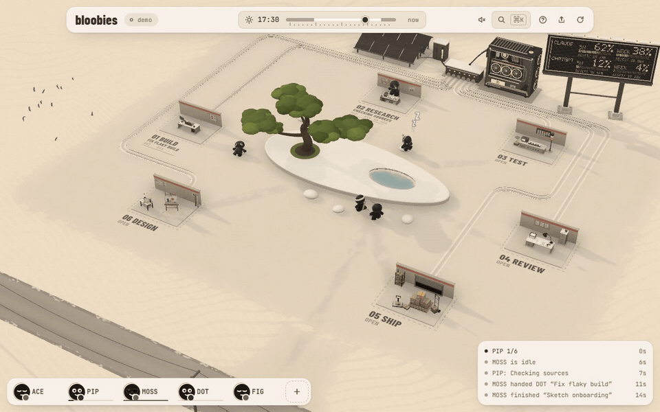

# bloobies for Claude Code

Watch your Claude Code agents work as a little crew at [bloobies.ai](https://bloobies.ai).



## Install

In Claude Code:

```text
/plugin install bloobies --marketplace yungprimer/bloobies
```

Then open [bloobies.ai](https://bloobies.ai) and sign in. It finds your agents by itself.

## What you get

<table>
  <tr>
    <td width="50%"></td>
    <td width="50%"></td>
  </tr>
  <tr>
    <td>Every agent and subagent is a bloobie, working at the station for what it's doing, with its task on the floor.</td>
    <td>They show how it's going: a "pls no" sign when blocked, a flag when one needs you, a headband when it's urgent.</td>
  </tr>
  <tr>
    <td></td>
    <td></td>
  </tr>
  <tr>
    <td>Your plan's 5-hour and weekly limits, and when they reset, on the board.</td>
    <td>Day turns to night with your own clock.</td>
  </tr>
</table>

## What it does

- When a Claude Code session starts, it makes sure a small bridge is running on `127.0.0.1:5318` (this machine
  only), and starts it in the background if not. The bridge stops by itself after 30 idle minutes.
- Claude Code's hooks tell the bridge what each agent is doing. The bridge turns that into world events and streams
  them to your bloobies.ai tab, straight from your machine to your browser.
- Your prompts, code and keys never reach bloobies.ai. Only pages from bloobies.ai (and this machine) may connect.

To stop it: `/plugin disable bloobies`, or uninstall it from `/plugin`.

© 2026 bloobies.ai. All rights reserved. [Terms](https://bloobies.ai/?view=terms)
